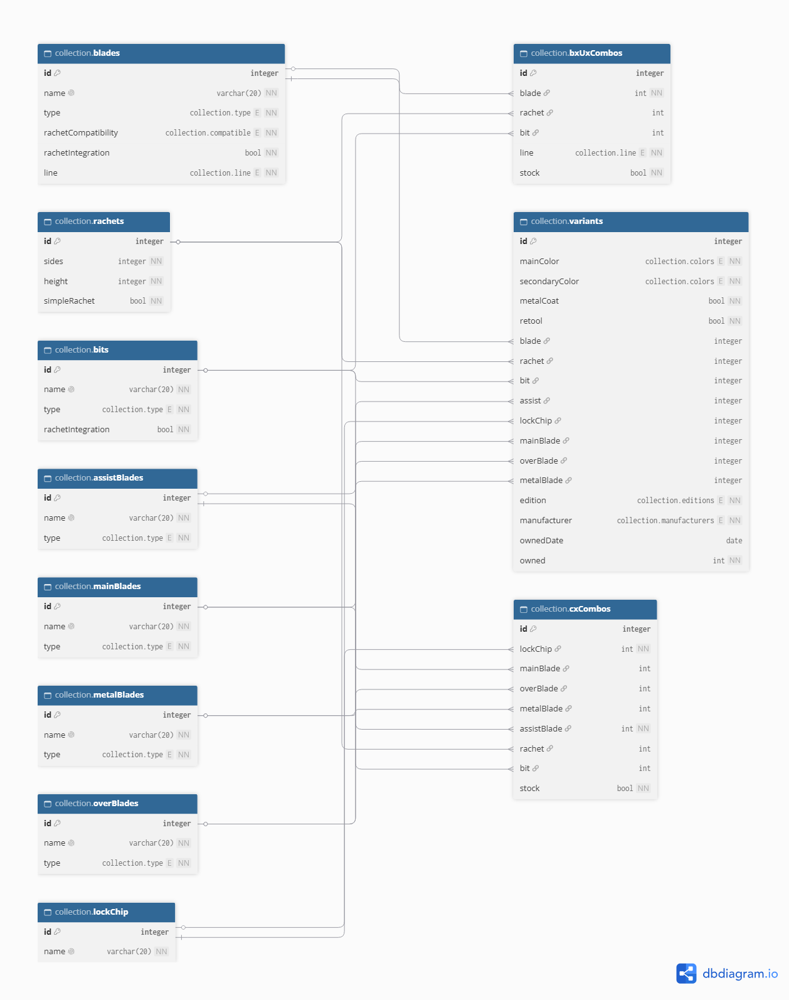

## ERD Documentation
This document covers the database structure for the Beybalde X lab website.
This is written in DMBL (Database Markup Language).

## Database Schema

```dbml
Enum collection.colors{
  blue
  red
  green
  black
  purple 
  bareMetal // For blades without metal coats
  clear
  noSecondary // unique for solid color items 
}

Enum collection.type{
  Attack
  Defense
  Stamina
  Balance
}

Enum collection.compatible{
  all_rachet_types
  only_simple_rachets
}

Enum collection.line{
  ux
  bx
}

Enum collection.manufacturers{
  hasbro
  takara_tomy
}

Enum collection.editions{
  standard_release
  alternate_colorway
  special_release
  collab_release

  //etc
}

Table collection.bxUxCombos{
  id integer [pk]
  blade int [not null, ref: > collection.blades.id]
  rachet int [ref: >? collection.rachets.id] // Has to either have rachet or bit
  bit int [ref: >? collection.bits.id] // Can not only be blade this allows integertions
  line collection.line [not null]
  stock bool [not null] // checks if stock combo
  checks {
    `rachet IS NOT NULL OR bit IS NOT NULL`
  }
}

Table collection.cxCombos{
  id integer [pk]
  lockChip int [not null, ref: > collection.lockChip.id]
  mainBlade int [ref: >? collection.mainBlades.id]
  overBlade int [ref: >? collection.overBlades.id]
  metalBlade int [ref: >? collection.metalBlades.id]
  assistBlade int [not null, ref: > collection.assistBlades.id]
  rachet int [ref: >? collection.rachets.id] // Has to either have rachet or bit
  bit int [ref: >? collection.bits.id] // Can not only be blade this allows integertions
  stock bool [not null]
  checks {
    `rachet IS NOT NULL OR bit IS NOT NULL`
    `mainBlade IS NOT NULL AND (overBlade IS NULL AND metalBlade IS NULL) OR
    mainBlade IS NULL AND (overBlade IS NOT NULL AND metalBlade IS NOT NULL)`
  }
}


Table collection.variants{
  id integer [pk]
  mainColor collection.colors [not null]
  secondaryColor collection.colors [not null]
  metalCoat bool [not null]
  retool bool [not null]
  blade integer [ref: >? collection.blades.id]
  rachet integer [ref: >? collection.rachets.id]
  bit integer [ref: >? collection.bits.id]
  assist integer [ref: >? collection.assistBlades.id]
  lockChip integer [ref: >? collection.lockChip.id]
  mainBlade integer [ref: >? collection.mainBlades.id]
  overBlade integer [ref: >? collection.overBlades.id]
  metalBlade integer [ref: >? collection.metalBlades.id]
  edition collection.editions [not null]
  manufacturer collection.manufacturers [not null] 
  ownedDate date // Date a variant was first acquired 
  owned int [not null, check: `owned BETWEEN 0 AND 999`]

  indexes {
    (blade, edition,mainColor,secondaryColor,metalCoat, manufacturer) [unique]
    (rachet, edition,mainColor,secondaryColor,metalCoat, manufacturer) [unique]
    (bit, edition,mainColor,secondaryColor,metalCoat, manufacturer) [unique]
    (assist, edition,mainColor,secondaryColor,metalCoat, manufacturer) [unique]
    (lockChip, edition,mainColor,secondaryColor,metalCoat, manufacturer) [unique]
    (mainBlade, edition,mainColor,secondaryColor,metalCoat, manufacturer) [unique]
    (overBlade, edition,mainColor,secondaryColor,metalCoat, manufacturer) [unique]
    (metalBlade, edition,mainColor,secondaryColor,metalCoat, manufacturer) [unique]
  }

  checks {
    `(CASE WHEN blade IS NOT NULL THEN 1 ELSE 0 END) +
    (CASE WHEN rachet IS NOT NULL THEN 1 ELSE 0 END) +
    (CASE WHEN bit IS NOT NULL THEN 1 ELSE 0 END) +
    (CASE WHEN lockChip IS NOT NULL THEN 1 ELSE 0 END) +
    (CASE WHEN mainBlade IS NOT NULL THEN 1 ELSE 0 END) +
    (CASE WHEN assist IS NOT NULL THEN 1 ELSE 0 END) +
    (CASE WHEN overBlade IS NOT NULL THEN 1 ELSE 0 END) +
    (CASE WHEN metalBlade IS NOT NULL THEN 1 ELSE 0 END) = 1`
  }
}

Table collection.blades{
  id integer [pk]
  name varchar(20) [unique, not null]
  type collection.type [not null]
  rachetCompatibility collection.compatible [not null]
  rachetIntegration bool [not null] 
  line collection.line [not null]
}

Table collection.rachets{
  id integer [pk]
  sides integer [not null, check: `sides BETWEEN 0 AND 9`] // has to be between 0 and 9
  height integer [not null, check: `height BETWEEN 50 AND 90`] // has to fall between 50 and 90 currently
  simpleRachet bool [not null] 
}

Table collection.bits{
  id integer [pk]
  name varchar(20) [unique, not null]
  type collection.type [not null] 
  rachetIntegration bool [not null] 
}

Table collection.assistBlades{
  id integer [pk]
  name varchar(20) [unique, not null]
  type collection.type [not null] 
}

Table collection.mainBlades{
  id integer [pk]
  name varchar(20) [unique, not null]
  type collection.type [not null] 
}

Table collection.metalBlades{
  id integer [pk]
  name varchar(20) [unique, not null]
  type collection.type [not null] 
}

Table collection.overBlades{
  id integer [pk]
  name varchar(20) [unique, not null]
  type collection.type [not null] 
}

Table collection.lockChip{
  id integer [pk]
  name varchar(20) [unique, not null]
}
```

## Entity Relationship Diagram
